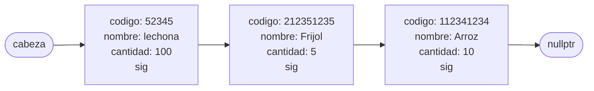
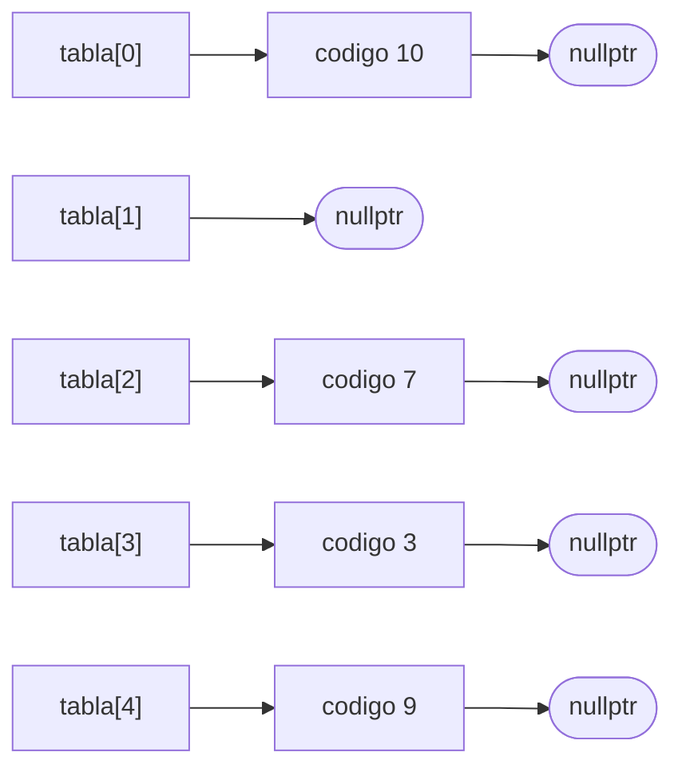
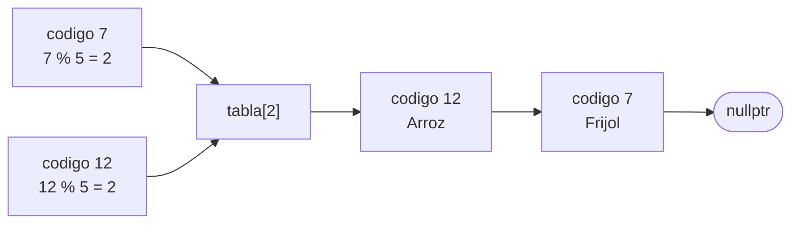
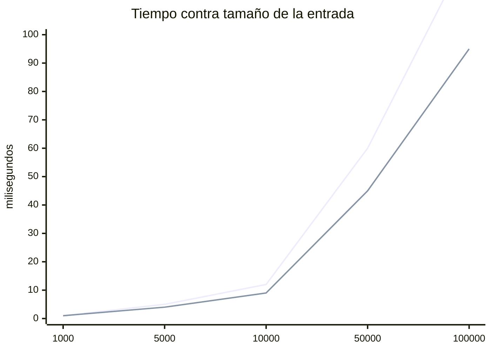

# Informe final

*(Parte del informe del avance, corregido con la realimentación.)*

## 1. El escenario y el modelado

El escenario seleccionado corresponde al inventario de una tienda, el programa permite almacenar y administrar productos mediante un código que identifica a cada uno.

Cada producto tiene tres datos: un código entero, un nombre y una cantidad disponible. El código se utiliza como clave para identificar los productos y evitar que se agreguen dos productos con el mismo código.

El sistema permite realizar las siguientes operaciones:

- **AGREGAR:** registra un producto nuevo con su código, nombre y cantidad.
- **ELIMINAR:** elimina un producto utilizando su código.
- **CONSULTAR:** busca un producto y muestra su nombre y cantidad.
- **REPONER:** aumenta la cantidad disponible de un producto.
- **LISTAR:** muestra todos los productos almacenados.

Para implementar el inventario se utiliza una lista enlazada simple y una tabla hash con encadenamiento, además, se utiliza `map` de C++ como estructura de referencia para comparar los tiempos de ejecución.

En las estructuras implementadas, cada producto se almacena con su código, nombre y cantidad, en la lista enlazada, los productos se conectan mediante punteros entre nodos, en la tabla hash, el código del producto determina la cubeta donde se almacena mediante la operación módulo.

# Diagramas del informe

Lista enlazada con nodos y punteros

Se insertó Arroz, luego Frijol y luego lechona. Como agregarProducto inserta al inicio, queda en orden inverso:

Tabla hash con varias cubetas (M = 5, hash = codigo % M)

Colision: dos codigos en la misma cubeta
 

## 2. Las dos estructuras

### Lista enlazada simple

Cada nodo almacena el código, nombre y cantidad de un producto, además de un puntero al siguiente nodo, la lista permite agregar, consultar, eliminar, reponer y listar productos mediante recorridos desde la cabeza.

### Tabla hash con encadenamiento

Utiliza un arreglo de cubetas, donde cada producto se almacena según el resultado de la función hash:

$$h(codigo) = codigo \bmod M$$

Si varios productos llegan a la misma cubeta, se almacenan en una lista enlazada.

### Interfaz de las estructuras

Ambas estructuras permiten realizar las mismas operaciones: agregar, eliminar, consultar, reponer y listar productos.

### Estructura de referencia: map de C++

Se utiliza `map` de C++ como referencia para comparar los tiempos de ejecución. Almacena los productos usando su código como clave y mantiene las claves ordenadas.

Diagramas mermaid de cada una de las 2 estructuras usadas.

## 3. Análisis formal de complejidad

Una demostración por operación no trivial, en cuatro partes:

**Teorema.** (Enunciado con la cota.)

**Demostración.** Se procede de forma directa. (La estrategia.)

*Desarrollo.* (La cadena de desigualdades, con la justificación de cada
paso.)

$$T(n) = \ldots \leq c \cdot n^2 \quad \text{para todo } n \geq k$$

*Conclusión.* Por lo tanto, $T(n) \in O(n^2)$ con testigos $c = \ldots$
y $k = \ldots$

Resumen de costos:

| Operación | Desde cero | De la biblioteca | Por qué |
|---|---|---|---|
|  |  |  |  |

### Demostraciones de complejidad

Para las demostraciones se usa $n$ como la cantidad de productos almacenados. En la tabla hash, $b$ representa la cantidad de productos que hay en la cubeta consultada, por lo que $0\leq b\leq n$.

#### Lista enlazada

**Teorema 1.** Consultar un producto en la lista enlazada tiene complejidad $O(n)$ en el peor caso.

**Demostración.** Se recorre la lista desde la cabeza hasta encontrar el código o llegar al final.

**Desarrollo.** En el peor caso se revisan los $n$ nodos. Si cada revisión cuesta como máximo una constante $a$ y el resto de operaciones cuesta $d$, entonces:

$$T(n)\leq an+d.$$

Para $n\geq 1$, se cumple $an+d\leq (a+d)n$. Tomando $c=a+d$ y $k=1$, se obtiene $T(n)\leq cn$.

**Conclusión.** $T(n)\in O(n)$, con testigos $c=a+d$ y $k=1$.

**Teorema 2.** Agregar un producto a la lista enlazada tiene complejidad $O(n)$ en el peor caso.

**Demostración.** Antes de insertar, el método busca si el código ya existe. Si no existe, crea el nodo y lo enlaza al inicio en tiempo constante.

**Desarrollo.** La búsqueda revisa como máximo $n$ nodos y la inserción realiza una cantidad constante de operaciones. Por tanto:

$$T(n)\leq an+d\leq (a+d)n,\qquad n\geq 1.$$

Tomando $c=a+d$ y $k=1$, se cumple la definición de $O(n)$.

**Conclusión.** $T(n)\in O(n)$, con testigos $c=a+d$ y $k=1$.

**Teorema 3.** Eliminar un producto de la lista enlazada tiene complejidad $O(n)$ en el peor caso.

**Demostración.** Se recorre la lista hasta encontrar el producto. Una vez encontrado, se ajustan los punteros y se libera el nodo, operaciones que toman tiempo constante.

**Desarrollo.** Como se pueden revisar los $n$ nodos, existe una constante $a$ para el recorrido y una constante $d$ para el ajuste de punteros y la eliminación:

$$T(n)\leq an+d\leq (a+d)n,\qquad n\geq 1.$$

Con $c=a+d$ y $k=1$, se obtiene la cota requerida.

**Conclusión.** $T(n)\in O(n)$, con testigos $c=a+d$ y $k=1$.

**Teorema 4.** Reponer un producto en la lista enlazada tiene complejidad $O(n)$ en el peor caso.

**Demostración.** El método busca el producto por su código y, si lo encuentra, actualiza su cantidad en tiempo constante.

**Desarrollo.** La búsqueda revisa como máximo $n$ nodos y la actualización cuesta una constante:

$$T(n)\leq an+d\leq (a+d)n,\qquad n\geq 1.$$

Tomando $c=a+d$ y $k=1$, se cumple la definición.

**Conclusión.** $T(n)\in O(n)$, con testigos $c=a+d$ y $k=1$.

**Teorema 5.** Listar los productos de la lista enlazada tiene complejidad $O(n)$.

**Demostración.** El método visita cada nodo una sola vez e imprime sus datos.

**Desarrollo.** Si visitar e imprimir cada nodo cuesta como máximo $a$ y existe un costo fijo $d$, entonces:

$$T(n)\leq an+d\leq (a+d)n,\qquad n\geq 1.$$

Con $c=a+d$ y $k=1$, la cota queda demostrada.

**Conclusión.** $T(n)\in O(n)$, con testigos $c=a+d$ y $k=1$.

#### Tabla hash con encadenamiento

**Teorema 6.** Consultar, agregar, eliminar o reponer un producto en la tabla hash tiene complejidad $O(b)$ para una cubeta con $b$ productos y, en el peor caso, $O(n)$.

**Demostración.** La función hash calcula la cubeta en tiempo constante. Después, la operación correspondiente se realiza sobre la lista enlazada de esa cubeta.

**Desarrollo.** El recorrido de la lista de la cubeta revisa como máximo $b$ nodos. Las operaciones adicionales de insertar, actualizar o desconectar un nodo cuestan tiempo constante. Por tanto, para constantes $a$ y $d$:

$$T(b)\leq ab+d\leq (a+d)b,\qquad b\geq 1.$$

Como $b\leq n$, también se cumple $T(n)\leq an+d\leq (a+d)n$ para $n\geq 1$. Así, se pueden tomar $c=a+d$ y $k=1$ para la cota $O(n)$ del peor caso.

**Conclusión.** Cada una de estas operaciones cuesta $O(b)$ en la cubeta correspondiente y $O(n)$ en el peor caso, con testigos $c=a+d$ y $k=1$ para la cota peor caso.

**Teorema 7.** Listar todos los productos de la tabla hash tiene complejidad $O(M+n)$, donde $M$ es la cantidad de cubetas.

**Demostración.** El método recorre las $M$ cubetas y lista los nodos de cada lista. Cada producto pertenece a una sola cubeta y se visita una vez.

**Desarrollo.** Recorrer las cubetas cuesta como máximo $aM$ y visitar todos los nodos cuesta como máximo $bn$. Para constantes $a$ y $b$:

$$T(M,n)\leq aM+bn\leq (a+b)(M+n).$$

Tomando $c=a+b$ y $k=1$, se obtiene la cota $O(M+n)$.

**Conclusión.** $T(M,n)\in O(M+n)$, con testigos $c=a+b$ y $k=1$.

#### Referencia de la biblioteca

La estructura `map` de C++ mantiene sus claves ordenadas. Sus operaciones de búsqueda, inserción y eliminación tienen complejidad $O(\log n)$; listar todos los elementos cuesta $O(n)$ porque se recorren sus elementos una vez.

### Resumen de costos

| Operación | Lista enlazada | Tabla hash | `map` de C++ |
|---|---:|---:|---:|
| Agregar | $O(n)$ | $O(n)$ peor caso | $O(\log n)$ |
| Consultar | $O(n)$ | $O(n)$ peor caso | $O(\log n)$ |
| Reponer | $O(n)$ | $O(n)$ peor caso | $O(\log n)$ |
| Eliminar | $O(n)$ | $O(n)$ peor caso | $O(\log n)$ |
| Listar | $O(n)$ | $O(M+n)$ | $O(n)$ |

En la tabla hash, las operaciones individuales pueden ser $O(1)$ en promedio cuando los productos se distribuyen entre las cubetas; sin embargo, si todos los productos caen en una misma cubeta, el costo llega a $O(n)$.

## 4. Experimentos

Máquina, compilador y banderas con que se midió; cómo se generaron las
entradas; cuántas repeticiones por tamaño.

| $n$ | desde cero (ms) | biblioteca (ms) |
|---|---|---|
| 1000 |  |  |
| 5000 |  |  |
| 10000 |  |  |
| 50000 |  |  |
| 100000 |  |  |

## 5. Lo medido contra lo predicho

(¿Coincide la curva con la cota? Donde no coincida, expliquen por qué:
la constante oculta, la memoria caché, el crecimiento del vector.)

## 6. Conclusiones

Para el escenario de inventario de una tienda, consideramos que la tabla hash con encadenamiento es una buena opción, ya que permite buscar los productos a partir de su código sin tener que recorrer toda la lista en condiciones normales, sin embargo, su rendimiento depende de la distribución de los códigos y de la cantidad de colisiones que se presenten.

La lista enlazada es sencilla de implementar, pero sus operaciones de búsqueda, eliminación y reposición pueden requerir recorrer todos los productos, por otro lado, map permite buscar los productos de forma eficiente y mantiene las claves ordenadas, aunque utiliza una estructura proporcionada por la biblioteca de C++.

En conclusión, para este inventario elegiríamos la tabla hash porque las consultas se realizan mediante el código del producto, si fuera necesario mantener los productos ordenados por código, map sería una alternativa conveniente, La lista enlazada puede ser útil cuando se busca una implementación más sencilla y no se requiere hacer búsquedas frecuentes.
